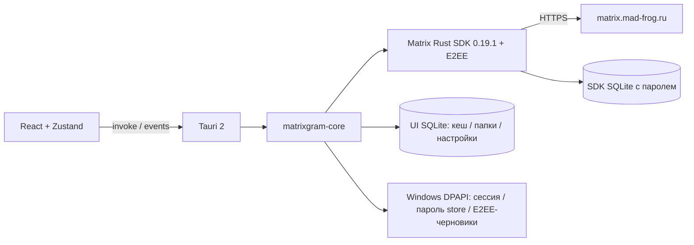

# Архитектура 0.3.0

Один Tauri-клиент использует WebView2 на Windows и системный WebView на Android. Ядро не зависит от Tauri и проверяется на локальном wiremock. Сеть выполняет Rust, интерфейс получает публичные модели без токена и пароля хранилища.

`Account` владеет SDK Client, кешем, флагом доступа к E2EE и блокировками операций. Backend содержит одну активную сессию и одну задачу обычного Matrix sync. События несут ключ userId|deviceId, чтобы UI отбрасывал обновления старого аккаунта. Ошибки ведут к переподключению с задержкой 2–30 секунд поверх retry SDK.

История — по 50 событий через SDK Room.messages, который расшифровывает доступные события. Ключи существующего backup запрашиваются при открытии E2EE-истории после восстановления. События объединяются по event_id. Исходящие повторы используют тот же transaction ID в пределах процесса.

До действия пользователя известные E2EE-комнаты не загружают историю и не отправляют отметку прочтения. После включения криптография остаётся на стороне SDK; UI получает расшифрованные события или placeholder отсутствующего ключа. Расшифрованная E2EE-история не записывается в открытый кеш приложения.

## Хранилища

- Tauri app_local_data_dir, identifier `ru.madfrog.matrixgram`.
- `accounts/{uuid}/sdk-e2ee-v1/` — SQLite SDK с отдельным случайным паролем, включая crypto store.
- `accounts/{uuid}/timeline.sqlite3` — обычные события, комнаты, черновики, redactions и settings; schema version 2, WAL.
- settings содержит folders, e2ee_enabled и локальное соответствие личных комнат пользователям. Папки относятся к текущей локальной сессии аккаунта, синхронизации между устройствами нет.
- `accounts/{uuid}/private-drafts/{uuid}` — DPAPI-черновики известных E2EE-комнат на Windows.
- `session.dpapi` — Matrix-сессия и пароль SDK store. Старая сессия 0.1.0 сохраняет device ID и получает новый SDK store без удаления прежнего кеша.
- LocalStorage — тема, ширина списка и закреплённые чаты, без токена, recovery key или паролей.

Список комнат и сообщения виртуализированы. Проекция проверяет входные поля, авторство правок, реакции и redaction. HTML остаётся текстом. Расшифрованное событие не заменяется старой копией ciphertext из истории.

Сохранение SDK и UI-кеша не является одной транзакцией; после аварии может понадобиться повторная загрузка истории. Durable outbox, лимит/очистка кеша и multi-account остаются в плане.

## Источники API

[Matrix SDK 0.19.1 features](https://docs.rs/crate/matrix-sdk/0.19.1/features), [Recovery API](https://docs.rs/matrix-sdk/0.19.1/matrix_sdk/encryption/recovery/struct.Recovery.html), [Matrix Client-Server API](https://spec.matrix.org/latest/client-server-api/), [Tauri prerequisites](https://v2.tauri.app/start/prerequisites/). Точные зависимости зафиксированы в Cargo.lock и package-lock.json.

Вёрстка 0.3.0 описана в [UI.md](UI.md). Изменение оформления не меняет формат сессии, SDK store, кеша и папок.
