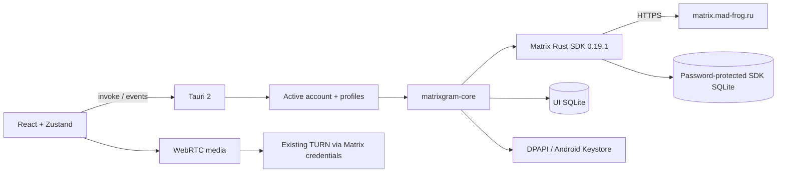

# Архитектура 0.5.2

Сеть Matrix и криптографию выполняет Rust SDK. WebView получает публичные модели, SDP/ICE и медиа, но не access token или пароль SDK store. WebRTC передаёт медиа; сигналы идут через SDK room send и автоматически шифруются для E2EE-комнат.

Backend держит один активный sync worker и до 10 сохранённых профилей. Неактивные SDK-клиенты могут оставаться в памяти без sync. Переключение отменяет загрузки, останавливает старый worker и очищает UI; события помечены userId|deviceId. Неактивные аккаунты не получают уведомления в фоне.

Старый каталог остаётся профилем legacy без переноса сессии. `profiles.json` содержит только id/userId/homeserver и активный id. Новый профиль имеет корень `profiles/{uuid}`; внутри сохраняется прежняя структура Account: accounts/{store-id}/sdk-e2ee-v1, timeline.sqlite3 и private-drafts. Профильные ID проверяются как канонические UUID, legacy — специальное значение. Session-файл остаётся защищён DPAPI/Keystore.

SDK SQLite использует случайный пароль. В UI SQLite открыто хранятся обычные события/комнаты/папки/настройки; E2EE-история туда не записывается. E2EE-черновики используют системный vault. Обычный кеш после logout не удаляется.

История загружается страницами, объединяется по event_id и виртуализируется. Проекция проверяет авторство правок, redaction и расшифрованные события. Matrix HTML преобразуется в React-элементы из белого списка без DOM injection. Mentions создаются по полным Matrix ID; правка уведомляет только новых участников, пересылка убирает reply relation и повторные mentions.

Глобальная очередь файлов имеет два параллельных отправителя и до 100 ожидающих/неуспешных файлов, лимит файла 25 МБ. Stable txn сохраняется при повторе. Отмена использует CancellationToken; она не откатывает уже принятый сервером event. Очередь не переживает завершение процесса. Медиа скачиваются авторизованно через SDK без дискового media cache; фронтенд кеширует не больше 20 записей / 32 МБ base64 и очищает их при смене аккаунта. Blob URL освобождаются при unmount.

Темы/масштаб/фон/ширина/настройки уведомлений находятся в localStorage; токенов и recovery keys там нет. Полная схема оставшихся работ — ROADMAP.md.

Список диалогов строится из серверных RoomSummary и временной проекции `presentRoom`. Rust отдаёт directUserId из `m.direct` и фото единственного другого участника DM. Расшифрованные lastBody не возвращаются в UI SQLite: `RoomPreviews` после явного unlock подгружает страницы в Zustand двумя worker, без отправки read receipt. Проекция учитывает edits/redaction и placeholder последнего недоступного события.

Личные подписи хранятся в LocalStorage под ключом origin homeserver + userId. Store загружает их при смене session и очищает текущую карту при выходе; сохранённые подписи этого аккаунта остаются для следующего входа. Ни RoomSummary, ни Matrix профиль на сервере ими не заменяются.

`ForwardDialog` получает снимок выбранных сообщений (максимум 100), сортирует по timestamp/event ID и отправляет по одному через существующий Rust forward. В памяти окна сохраняются transaction ID каждого события и набор доставленных ID. Частичная ошибка не разрешает сменить получателя: повтор продолжает ту же пачку. При закрытии новые запросы прекращаются, принятые сервером не откатываются. Смена чата размонтирует окно.

Chat и RoomInfo имеют разные sibling keys (`chat:` / `info:`); desktop grid задаёт каждой области явные ряд/колонку. Это исключает воспроизведённые orphan-панели при reconciliation со сменой комнаты.

В 0.5.1 `cachedTimeline` использует WeakMap с ключом — неизменяемым массивом событий Zustand. `mergeEvents` всегда создаёт новый снимок при изменении; старая проекция может быть собрана GC после удаления ссылок на массив. Кеш не сохраняется на диск и не обходит проверку E2EE в `presentRoom`. Это обмен небольшого дополнительного объёма JS heap на снижение повторной работы CPU.

Поиск использует Map исходных имён и Set для папок/закреплений; индексы участников/сообщений и расчёт readThrough обновляются только при изменении соответствующего снимка. Memo Chat сравнивает все поля DTO, сохраняя обновления сообщений через собственные подписки Zustand. Таймер typing работает лишь при наличии печатающих участников. Pending сохраняет ссылку, если sync не удалил ни одного ожидающего сообщения.

История имеет отдельный WeakMap незавершённых запросов на объект сессии; ключ включает room ID, режим и cursor. После успеха или ошибки запись удаляется, повтор разрешён; старая сессия не может обновить новую. SQLite statement cache переиспользует SQL без изменения схемы, транзакций и правил redaction/deduplication.

Обновления независимы от Matrix-сессии. `Updates` хранит проверенный candidate и подготовленный пакет под отдельным Tokio Mutex; IPC не принимает URL, ключ или исполняемую команду от WebView. Check сбрасывает предыдущий candidate; install требует предварительной загрузки. Desktop применяет официальный Tauri updater с обязательной привязкой подписанной версии. Android использует HTTPS manifest, minisign-verify и JNI-вызов системного APK installer; пакет ограничен 256 МиБ. Секреты подписи находятся вне Git и в Actions Secrets, в приложение включён лишь публичный ключ. Настройки updater не меняют Synapse/TURN.
