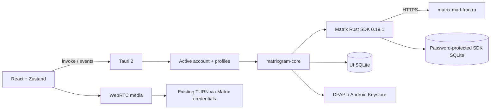

# Архитектура 0.4.0

Сеть Matrix и криптографию выполняет Rust SDK. WebView получает публичные модели, SDP/ICE и медиа, но не access token или пароль SDK store. WebRTC передаёт медиа; сигналы идут через SDK room send и автоматически шифруются для E2EE-комнат.

Backend держит один активный sync worker и до 10 сохранённых профилей. Неактивные SDK-клиенты могут оставаться в памяти без sync. Переключение отменяет загрузки, останавливает старый worker и очищает UI; события помечены userId|deviceId. Неактивные аккаунты не получают уведомления в фоне.

Старый каталог остаётся профилем legacy без переноса сессии. `profiles.json` содержит только id/userId/homeserver и активный id. Новый профиль имеет корень `profiles/{uuid}`; внутри сохраняется прежняя структура Account: accounts/{store-id}/sdk-e2ee-v1, timeline.sqlite3 и private-drafts. Профильные ID проверяются как канонические UUID, legacy — специальное значение. Session-файл остаётся защищён DPAPI/Keystore.

SDK SQLite использует случайный пароль. В UI SQLite открыто хранятся обычные события/комнаты/папки/настройки; E2EE-история туда не записывается. E2EE-черновики используют системный vault. Обычный кеш после logout не удаляется.

История загружается страницами, объединяется по event_id и виртуализируется. Проекция проверяет авторство правок, redaction и расшифрованные события. Matrix HTML преобразуется в React-элементы из белого списка без DOM injection. Mentions создаются по полным Matrix ID; правка уведомляет только новых участников, пересылка убирает reply relation и повторные mentions.

Глобальная очередь файлов имеет два параллельных отправителя и до 100 ожидающих/неуспешных файлов, лимит файла 25 МБ. Stable txn сохраняется при повторе. Отмена использует CancellationToken; она не откатывает уже принятый сервером event. Очередь не переживает завершение процесса. Медиа скачиваются авторизованно через SDK без дискового media cache; фронтенд кеширует не больше 20 записей / 32 МБ base64 и очищает их при смене аккаунта. Blob URL освобождаются при unmount.

Темы/масштаб/фон/ширина/настройки уведомлений находятся в localStorage; токенов и recovery keys там нет. Полная схема оставшихся работ — ROADMAP.md.
