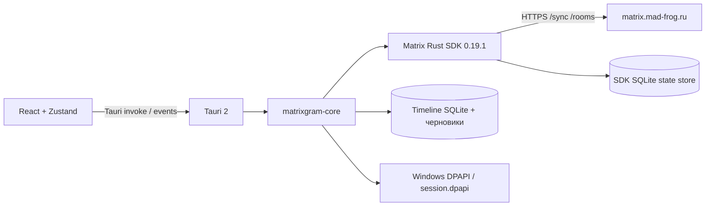

# Архитектура

## Единое ядро

`apps/client` — одно приложение Tauri 2 с адаптивным интерфейсом. Windows использует WebView2, Android — системный WebView. `crates/matrixgram-core` не зависит от Tauri: его можно проверять на локальном тестовом сервере.

`Account` владеет `Client`, SQLite-кешем и публичным описанием сессии без токена. Tauri `Backend` управляет жизненным циклом аккаунта и одной задачей синхронизации. UI получает `matrix-update` с ключом `userId|deviceId`; обновления старых сессий отбрасываются.

## Синхронизация и история

Используется обычный `/sync`, без необходимости менять настройки Synapse или включать Sliding Sync. После успешной синхронизации SDK сохраняет своё состояние, ядро сохраняет события и обновления комнат, затем отправляет событие интерфейсу. Ошибки запускают переподключение с задержкой 2–30 секунд поверх retry SDK.

История запрашивается через `/rooms/{roomId}/messages` по 50 событий. Начальная история открывается с конца; следующие страницы используют серверный cursor. События объединяются по `event_id`. SDK хранит токен синхронизации; приложение кеширует последние 500 событий на открытие комнаты, а старые страницы остаются в БД и доступны через серверную пагинацию.

Списки комнат и сообщений виртуализированы `@tanstack/react-virtual`. Проекция в `timeline.ts` обрабатывает редактирование только от автора исходного сообщения, реакции, ответы и redaction. Сервер отвечает за авторизацию Matrix-событий. HTML не исполняется: сообщения выводятся как текст React.

Операции SDK и локального кеша не составляют одной транзакции. При аварии между их сохранением возможен пропуск локального события, который восстанавливается повторным запросом истории. Durable outbox пока нет: повтор отправки доступен в пределах процесса с тем же `txn`.

## Хранилища

- Путь данных выбирает Tauri `app_local_data_dir`, идентификатор приложения `ru.madfrog.matrixgram`.
- `accounts/{uuid}/` — отдельное SQLite-хранилище SDK для созданной сессии.
- `accounts/{uuid}/timeline.sqlite3` — таблицы `events`, `rooms`, `drafts`, `redactions`, WAL.
- `session.dpapi` — защищённая Windows сессия с токеном и ссылкой на UUID-хранилище.
- LocalStorage — только тема и локальное закрепление чатов; паролей и токенов там нет.

Кеш переписок не зашифрован на уровне приложения. После выхода старый кеш остаётся на диске и не открывается новой сессией. Очистка кеша, лимит его размера, управление несколькими аккаунтами и миграции после первой схемы ещё нужны.

## Зафиксированные источники API

Проверено 29 октября 2026: [функции Matrix SDK 0.19.1](https://docs.rs/crate/matrix-sdk/0.19.1/features), [ClientBuilder](https://docs.rs/matrix-sdk/0.19.1/matrix_sdk/struct.ClientBuilder.html), [Matrix Client-Server API](https://spec.matrix.org/latest/client-server-api/), [Tauri prerequisites](https://v2.tauri.app/start/prerequisites/). SDK требует Rust не ниже 1.96; проект закрепляет 1.99.1. Фактические версии зависимостей находятся в Cargo.lock и package-lock.json.
